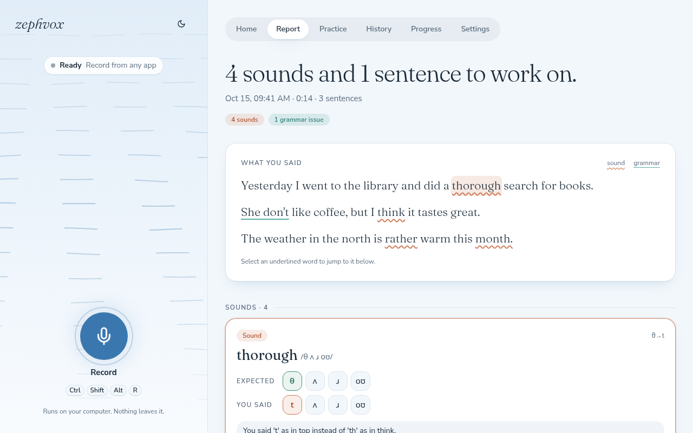
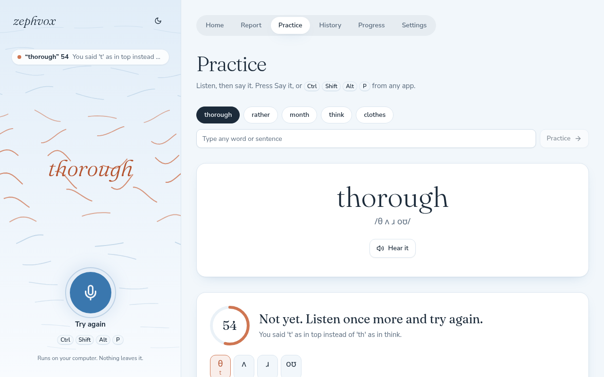
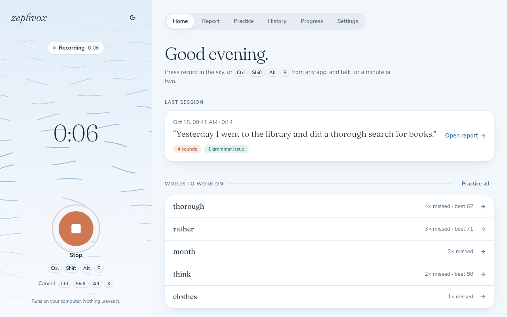
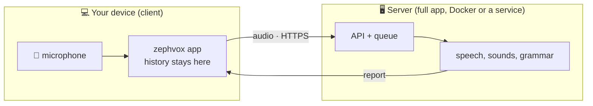
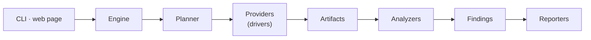

<div align="center">


# zephvox

**Say it. See what to fix.**

Record yourself speaking English and get the *sounds* and *sentences* to work on, each with what you
said and what it should have been. Then practice them until they pass.

[](LICENSE)
[](pyproject.toml)
[](#-install)
[](#-features)
[](#-limitations)

[**Install**](#-install) ·
[**Features**](#-features) ·
[**Using it**](#-using-zephvox) ·
[**Server mode**](#-server-mode) ·
[**Architecture**](#-architecture) ·
[**Website**](https://dipoahmed018.github.io/zephvox/)

<picture>
  <source media="(prefers-color-scheme: dark)" srcset="docs/assets/screenshots/report-dark.png">
  
</picture>

</div>

## ✨ Features

| | |
|---|---|
| 🎤 **One shortcut, anywhere** | Press **Ctrl+Shift+Alt+R** from any app, talk, press it again. A desktop note tells you when your report is ready. |
| 🔊 **Sounds, not just words** | Expected sounds lined up against the ones you made, so a dropped or swapped sound is obvious (`θ → t`). |
| 📝 **Grammar, with the fix** | The sentence you said, the corrected one, and a short reason. Mark a false alarm and it's ignored from then on. |
| 🎯 **Practice that scores you** | Say a word, get 0–100 within a moment, every sound marked right or wrong, and a mouth tip. It stops listening when you stop talking. |
| 🌬️ **A page that shows what's happening** | Wind that follows your voice while you record, and carries your words through each analysis step. Calm when idle. |
| 📈 **Progress** | Your weakest words and the sounds you mix up most, across every recording. |
| 🔒 **Private by default** | Everything runs on your computer. Nothing is sent anywhere unless you connect to a server yourself. |
| 🧩 **Everything is a plugin** | Speech recognition, dictionaries, the grammar model, voices and shortcuts are drivers you can swap. |
| 🌐 **Or use a server** | A small client records here and a zephvox server analyzes. Share one machine's GPU with your other devices, or with other people. |

## 🚀 Install

One line installs everything into a single folder: `~/zephvox`, or `%LOCALAPPDATA%\zephvox` on Windows.

|  | 🖥️ Full app | ☁️ Client only |
|---|---|---|
| **Analysis runs** | on this computer | on a zephvox server |
| **Size** | a few GB (PyTorch and the models) | about 80 MB |
| **Needs** | 8 GB+ RAM; a GPU makes it fast | a server address and an invite code |
| **Works offline** | yes | recordings wait and are analyzed when the server is back |

### 🖥️ Full app

```sh
# macOS / Linux
curl -LsSf https://raw.githubusercontent.com/dipoahmed018/zephvox/main/install.sh | sh
```
```powershell
# Windows (PowerShell)
powershell -ExecutionPolicy ByPass -c "irm https://raw.githubusercontent.com/dipoahmed018/zephvox/main/install.ps1 | iex"
```

The script installs [uv](https://docs.astral.sh/uv/) if needed, downloads zephvox and starts
`zephvox setup`, which:

1. 🔍 **detects your hardware**: CPU, RAM, GPU and its memory, free disk space;
2. 🎚️ **recommends a profile** (below). Accept it or pick another;
3. 📋 **shows what it will download** and checks the disk space;
4. 🦙 **installs [Ollama](https://ollama.com)** for grammar, if you agree (winget, Homebrew, pacman or Ollama's script);
5. 🔥 **installs the matching PyTorch build** (NVIDIA → CUDA, AMD on Linux → ROCm, otherwise CPU; Macs use the Apple GPU);
6. ⬇️ **downloads the models** with progress bars;
7. 🚪 **adds zephvox to your app menu** and a `zephvox` command to your terminal;
8. ✅ **runs a test analysis** to check it all works.

Nothing else needs a system install: the pronunciation dictionary and ffmpeg's decoders come with the
Python packages.

### ☁️ Client only

Get the server's address and an **invite code** from whoever runs it, then:

```sh
curl -LsSf https://raw.githubusercontent.com/dipoahmed018/zephvox/main/install.sh | sh -s -- \
    --server-url https://speak.example.com --invite inv_...
```
```powershell
$env:ZEPHVOX_SETUP_ARGS = "--server-url https://speak.example.com --invite inv_..."
irm https://raw.githubusercontent.com/dipoahmed018/zephvox/main/install.ps1 | iex
```

The app works exactly as the full one: recordings, history and reports stay on your device, and only
the analysis runs on the server. Changed your mind? **Settings → Where analysis runs** switches
between the server and this computer, and offers to install the engine here if it isn't.

<details>
<summary><b>🎚️ Profiles</b>: how the full app picks its models</summary>

<br>

| Profile | Recommended for | Speech to text | Grammar model |
|---|---|---|---|
| `large` | GPU with 16 GB+, or a Mac with 32 GB+ | Whisper large-v3-turbo (GPU) | qwen3:14b |
| `standard` | GPU with 10–16 GB, or a Mac with 16 GB+ | Whisper large-v3-turbo (GPU) | qwen3:8b |
| `small` | GPU with 6–10 GB, or a Mac with 8 GB | Whisper large-v3-turbo (GPU) | qwen3:4b |
| `cpu` | no usable GPU, 16 GB+ RAM | Whisper small.en (faster-whisper) | qwen3:4b (slow) |
| `cpu-light` | under 16 GB RAM | Whisper base.en (faster-whisper) | off (a cloud LLM can be added) |
| `custom` | your own choices | any Whisper size, GPU or CPU | any Ollama model, an OpenAI-compatible API, or off |

**Custom** asks for each part in turn: GPU or CPU, the speech-to-text model, American or British
pronunciation, the grammar model (or an API, or none) and the practice voice. Each question shows
download sizes and starts from the recommended profile, so pressing Enter throughout gives that
profile. Your answers are saved in `custom-profile.toml` next to `config.toml`, and running setup
again starts from them. Without a terminal, `--profile custom` reuses the saved file.

Change profile any time in **Settings → General**, or with `zephvox setup` (which also installs
anything the new profile needs). A profile is only a starting point: anything you set in `config.toml`
or in Settings wins over it. These thresholds are first estimates; tell us if one doesn't suit your
machine.

</details>

<details>
<summary><b>🛠️ Commands, unattended installs and GPU notes</b></summary>

<br>

| Command | What it does |
|---|---|
| `zephvox serve --open` | start zephvox (or use the app-menu entry) |
| `zephvox setup` | review the profile, repair the install; `--dry-run` only shows the plan |
| `zephvox update` | install the latest release, keeping your settings |
| `zephvox uninstall` | remove it (asks before deleting models or your recordings) |

Unattended install: `curl … | sh -s -- --profile cpu --yes` (Windows: set
`ZEPHVOX_SETUP_ARGS="--profile cpu --yes"`). `ZEPHVOX_DIR` changes the folder.

- **NVIDIA:** the normal driver, 525 or newer. No CUDA toolkit is needed.
- **AMD on Linux:** PyTorch's ROCm build brings its own ROCm libraries. Your user must be in the
  `render` and `video` groups (setup tells you if not). If PyTorch can't use the card, setup offers
  the usual `HSA_OVERRIDE_GFX_VERSION` fix.
- **AMD and Intel GPUs on Windows** aren't supported by PyTorch, so those machines use a CPU profile.

**From a git checkout (development):**

```sh
git clone https://github.com/dipoahmed018/zephvox && cd zephvox
uv run zephvox setup      # same wizard; keeps the dev tools, and `update` is `git pull`
```

Or by hand: `uv sync --extra models --extra cuda --extra desktop --extra web --extra voice`, with
`cuda`, `rocm` or `cpu` for your hardware.

</details>

## 🎤 Using zephvox

```sh
zephvox serve --open          # http://127.0.0.1:8765, or use the app-menu entry
```

`serve` starts a local daemon: it keeps the models loaded, owns the microphone, registers the global
shortcuts and serves the page. The **browser never records**: it shows live feedback and lets you
practice, and the engine does the recording.

<table>
<tr>
<td width="50%">

**🎙️ Record.** Press **Ctrl+Shift+Alt+R** anywhere (or the big button), speak, press again. The sky
beside the page shows the state at a glance: wind that swells with your voice, then your words
drifting through *Transcribe → Sounds → Grammar* as each step finishes.

**📄 Report.** Your transcript with mistakes underlined (coral wave = sound, mint line = grammar).
Select one to hear your own word, hear it said correctly, practice it, or mark it "not a mistake".

</td>
<td width="50%">

**🎯 Practice.** Hear the word, press **Ctrl+Shift+Alt+P** (or the button) and say it. Recording stops
by itself when you stop talking. You get a 0–100 score, every sound marked, and a tip. Type any word
or sentence you like, or pick from the words you miss most.

**📈 History · Progress · Settings.** Past sessions (including ones waiting for their turn), your
weakest words and sounds, and every option below.

</td>
</tr>
</table>

<div align="center">
<picture>
  <source media="(prefers-color-scheme: dark)" srcset="docs/assets/screenshots/practice-dark.png">
  
</picture>
<picture>
  <source media="(prefers-color-scheme: dark)" srcset="docs/assets/screenshots/home-dark.png">
  
</picture>
</div>

### ⚙️ Settings: everything, in the page

Every option the command line and `config.toml` offer can be changed in **Settings**, and each change
is saved the moment you make it:

| Tab | What's in it |
|---|---|
| **General** | microphone, reference voice, which checks run, notifications, **shortcut keys** (click *Change*, press the new ones), where analysis runs, profile, theme |
| **Models & checks** | each stage's drivers in order of preference (move, add, remove, and why one can't run), every driver's options, thresholds for pronunciation, grammar and practice, **download** for a missing grammar model |
| **Devices** | the microphone and shortcut drivers |
| **Sharing** | run a server from this computer: accounts, invites, devices, limits and jobs ([below](#-server-mode)) |
| **Diagnostics** | hardware, file locations, and which drivers are in use |

Every value says where it comes from (*changed here*, `config.toml` or the profile) and can be reset.
Changes made in the page are kept apart from `config.toml`, which is never rewritten.

<details>
<summary><b>🎹 Global shortcuts: drivers and rebinding</b></summary>

<br>

| Driver | Where | Notes |
|---|---|---|
| `portal` | Linux (KDE Plasma, GNOME 48+, Hyprland; Wayland or X11) | Run `zephvox desktop-entry` once first, so the desktop files the shortcuts under "zephvox" (not your terminal). The desktop asks once. On KDE, keys changed in Settings are applied directly. |
| `pynput` | Windows, macOS, Linux X11 | macOS asks for Accessibility permission |
| any OS | — | Bind `zephvox toggle` / `zephvox practice` in your OS shortcut settings. Both talk to the running daemon. |

Or in `config.toml`:

```toml
[shortcuts]
toggle_recording = "Ctrl+Shift+Alt+R"
practice_attempt = "Ctrl+Shift+Alt+P"
cancel = "Ctrl+Shift+Alt+X"
```

Frontend development: `cd web && npm install && npm run dev` (Vite proxies `/api` to the daemon).
`npm run build` writes the production page into `src/zephvox/web/static/`. The design is described in
[`web/DESIGN.md`](web/DESIGN.md).

</details>

<details>
<summary><b>💻 Command line</b></summary>

<br>

| Command | What it does |
|---|---|
| `zephvox record` | record until you press Enter, then analyze |
| `zephvox start` / `zephvox stop` | record in the background (e.g. bind these to hotkeys) |
| `zephvox analyze talk.mp3` | analyze any audio file |
| `zephvox report [SESSION]` | show a saved report again (`--format markdown\|json`, `-o file`) |
| `zephvox history` | your most frequent mistakes across sessions |
| `zephvox providers` | which drivers are available, and which is selected |
| `zephvox serve` | daemon + web GUI + global shortcuts |
| `zephvox desktop-entry` | add zephvox to the app menu (Linux: also gives its shortcuts a proper name) |
| `zephvox toggle` / `zephvox practice` | start/stop a recording or practice attempt (uses the daemon when it runs) |

```
$ zephvox record
Speak now. Press Enter to stop…

Pronunciation (1)
  1. think: you said /s ɪ ŋ k/, expected /θ ɪ ŋ k/  (θ→s)
     You said 's' as in see instead of 'th' as in think.
     “I think we should go now.” [0:00.2]

Grammar (1)
  1. "he go" → "he went"  (verb-tense)
     Use the past tense with "yesterday".
     “Yesterday he go to the market.” [0:01.8]
```

When the daemon is running, `record`, `start`, `stop`, `toggle` and `practice` are forwarded to it.
Useful flags: `--analyzers grammar` (only one check), `--set stt=faster-whisper` (pick a driver),
`--config path.toml`. Sessions (audio + `result.json`) live in your OS's app-data folder
(Linux: `~/.local/share/zephvox/sessions/`).

</details>

## 🌐 Server mode

`zephvox server serve` runs the engine as a service: an API for whole recordings (async jobs) and
for practice (streamed while you speak). Clients connect with an **invite** that gives each device
its own key.



### 🔌 Running a server

| | How |
|---|---|
| **From the app** | **Settings → Sharing**. Turn on **Share** (choose *My network* so other devices can reach it), add an account, and give its invite to the device. The server runs inside the app and uses the models it already has loaded. Accounts, devices, limits, recent jobs and webhook secrets are all managed in that tab. |
| **Without the app** | `zephvox server serve`, or `zephvox server install-service` for a background service that starts with the computer (systemd user unit on Linux, LaunchAgent on macOS, scheduled task on Windows). `zephvox server remove-service` undoes it. |
| **Docker** | `docker compose -f docker/compose.yml up -d` (below). The headless way to host it 24/7. |

The same administration is available from the command line:

```sh
zephvox server accounts add alice
zephvox server invite alice --url https://speak.example.com     # one-time code for one device
zephvox server limits set alice --max-jobs 3 --max-audio-minutes 60
zephvox server devices list | jobs list | webhook-secret alice
```

Each device redeems an invite for its own key (`POST /v1/devices/redeem`) and sends it as
`Authorization: Bearer sk_...`. Keys are stored only as hashes and can be rotated or revoked.

**History sync** is on by default in client mode (a full install can turn it on in Settings):
sessions, feedback, recordings and practice scores are backed up to the server under your account,
and sessions from your other devices appear in History. The newest edit wins, and deleting a session
deletes it everywhere. If the server can't be reached, recording still works: the session waits
("waiting for the server" in History) and is analyzed as soon as it's back.

<details>
<summary><b>🐳 Docker</b></summary>

<br>

The zephvox server plus Ollama:

```sh
docker compose -f docker/compose.yml up -d                       # CPU
ZEPHVOX_ACCELERATOR=cuda docker compose -f docker/compose.yml -f docker/compose.cuda.yml up -d
ZEPHVOX_ACCELERATOR=rocm docker compose -f docker/compose.yml -f docker/compose.rocm.yml up -d
docker compose -f docker/compose.yml exec ollama ollama pull qwen3:8b
docker compose -f docker/compose.yml exec zephvox zephvox server accounts add me
```

Models download into a volume on first use. Settings are in `docker/config.toml`; mount your own over
`/app/config.toml` to change them. On a machine without a GPU, set `profile = "cpu"` in it.

</details>

<details>
<summary><b>🔒 HTTPS</b>: keys and recordings must not cross a network unencrypted</summary>

<br>

The server speaks plain HTTP, and clients warn about `http://` addresses that aren't on the same
machine. Put a reverse proxy in front. Caddy gets a certificate by itself and passes WebSockets through:

```
# Caddyfile
speak.example.com {
    reverse_proxy 127.0.0.1:8770
}
```

With nginx, pass the WebSocket upgrade for practice and allow large uploads:

```nginx
location / {
    proxy_pass http://127.0.0.1:8770;
    proxy_http_version 1.1;
    proxy_set_header Upgrade $http_upgrade;
    proxy_set_header Connection "upgrade";
    proxy_set_header Host $host;
    client_max_body_size 200m;
    proxy_read_timeout 600s;
}
```

</details>

<details>
<summary><b>📡 HTTP API</b></summary>

<br>

| API | What it does |
|---|---|
| `POST /v1/jobs` | upload audio (`audio`, optional `analyzers`, `webhook_url`; `Idempotency-Key` header) → `202` with the job id and `Location` |
| `GET /v1/jobs/{id}` · `/events` | status and result · live progress (SSE). Finished jobs are deleted after 24 h |
| `WS /v1/practice` | `start` (target text) → 16 kHz 16-bit mono PCM while speaking → `end` → score, typically under 0.1 s later |
| `GET /v1/tts` | reference pronunciation audio |
| `GET /v1/account`, `/v1/devices` | the account's limits, webhook secret and devices; `POST /v1/devices/me/rotate` for a new key |
| `GET/PUT/DELETE /v1/sessions/{id}` (+ `/audio`), `/v1/practice/attempts` | history sync (per account; storage limit applies) |

Webhooks are signed: `Zephvox-Signature: t=<unix>,v1=<HMAC-SHA256(webhook secret, "<t>.<body>")>`,
retried after 1, 5 and 30 minutes. Full API docs are served at `/v1/docs`. Settings and default
limits are under `[server]` in `config.example.toml`.

</details>

## 🧱 Architecture



- **Engine** (`src/zephvox/engine/`): sessions, plugin registry, config, capability detection,
  artifact planner, events. It knows nothing about pronunciation or grammar.
- **Providers** (`src/zephvox/providers/`): replaceable drivers, one contract per kind
  (`providers/base.py`).
- **Artifacts** (`engine/artifacts.py`): intermediate data computed once, only if an enabled analyzer
  needs it. Running grammar alone never loads the phoneme model.
- **Analyzers** (`src/zephvox/analyzers/`): abilities. Each declares the artifacts and providers it
  needs and returns `Finding`s in one shared format.
- **Reporters** (`src/zephvox/reporters/`): render findings as terminal text, Markdown or JSON.

| Kind | Built-in drivers (default first) |
|---|---|
| `capture` | `pipewire` (Linux), `sounddevice` (Windows/macOS/Linux) |
| `stt` | `hf-whisper` (transformers, GPU), `faster-whisper` (CPU) |
| `g2p` | `chain` (= `cmudict`, then `deep-phonemizer` for words it lacks), `cmudict`, `misaki` (US or UK dictionaries), `deep-phonemizer`; `espeak` as an optional plugin |
| `phonemes` | `wav2vec2` (`facebook/wav2vec2-lv-60-espeak-cv-ft`) |
| `llm` | `openai-compat` (Ollama `qwen3:8b` by default; also llama.cpp, vLLM, LM Studio, cloud APIs) |
| `tts` | `kokoro` (natural voices), `espeak-ng` (robotic, if installed on the system) |
| `triggers` | `portal`, `pynput` (global shortcuts) |

All G2P and phoneme drivers convert into one canonical IPA phone set (`engine/phonemes.py`). That
shared set is what makes mixing drivers safe.

Expected pronunciations come from the CMU Pronouncing Dictionary (shipped with zephvox). Short
acronyms are spelled out ("GPT") and compound words are split ("ChatGPT", "e-mail") before anything
is guessed. Words no dictionary has (names, brands, new words) are predicted from their spelling by a
small [DeepPhonemizer](https://github.com/as-ideas/DeepPhonemizer) model. For British English, use
the `misaki` driver with `accent = "en-gb"`.

If a check can't run (say the grammar model isn't downloaded), it is skipped with a note in the report
and the others still run.

### 🔧 Configuration

Everything can be changed in **Settings**. For files, two live in the project root, both git-ignored.
Copy them from their templates:

- **`config.toml`** (from `config.example.toml`, which lists and describes every setting): drivers,
  models, thresholds, shortcuts.
- **`.env`** (from `.env.example`): API keys and machine-specific environment variables (GPU
  overrides, model cache location). Variables already set in your shell win.

Both are found from where the code lives, so they apply however zephvox starts: from a terminal in
any folder, from the app menu, or from a global shortcut. `--config` or `ZEPHVOX_CONFIG` picks another
file. If you install zephvox as a package without the project folder, it uses your OS's config folder
instead: `~/.config/zephvox/`, `~/Library/Application Support/zephvox/` or `%LOCALAPPDATA%\zephvox\`.
`zephvox doctor` shows which files are in use.

Each stage takes a preference list, and the first available driver wins:

```toml
[engine]
analyzers = ["pronunciation", "grammar"]

[providers]
stt = ["hf-whisper", "faster-whisper"]
g2p = ["chain"]

[provider.hf-whisper]
model = "openai/whisper-large-v3-turbo"

[provider.chain]
order = ["cmudict", "deep-phonemizer"]   # UK English: ["misaki", "deep-phonemizer"] plus [provider.misaki] accent = "en-gb"

[provider.openai-compat]
model = "qwen3:8b"                 # or qwen3:14b: fits in 16 GB of VRAM
autostart = true                   # run `ollama serve` only during analysis (default)

[analyzer.pronunciation]
threshold = 0.3                    # higher = stricter about what counts as a mistake
```

### 🧩 Writing a plugin

Subclass the contract for its kind and register an entry point in your own package:

```toml
[project.entry-points."zephvox.stt"]
parakeet = "zephvox_parakeet:ParakeetSTT"
```

```python
from zephvox.providers.base import STTProvider, Availability

class ParakeetSTT(STTProvider):
    name = "parakeet"
    def check_available(self): ...          # cheap; say *why* if it can't run
    def transcribe(self, samples, sample_rate): ...   # -> Transcript with word timestamps
```

| Method | When | Typical use |
|---|---|---|
| `check_available()` | choosing a driver | cheap check; never loads models |
| `prepare()` | once, right before first use | server-based drivers start their server (e.g. Ollama `autostart`); raise to fall back to the next driver |
| first call (`transcribe`, …) | during analysis | in-process drivers load models lazily |
| `close()` | after the analysis | free GPU memory; stop only processes `prepare()` started |

A new ability works the same way: subclass `analyzers.base.Analyzer`, set `needs` and `uses`, return
`Finding`s, and register it under `zephvox.analyzers`. Reports, history and session storage pick it up
automatically. [`plugins/zephvox-espeak`](plugins/zephvox-espeak) is a complete example: it adds
espeak-ng's rules as the `espeak` driver (`uv sync --extra espeak`). It is GPL-licensed, so it stays a
separate package.

## 🧪 Tests

```sh
uv run pytest --cov                       # fast unit suite, no models needed
cd web && npm test                        # frontend unit tests
uv run python scripts/make_fixtures.py    # synthesize test audio with deliberate mistakes
uv run pytest -m "audio and models"       # real Whisper + G2P + wav2vec2
uv run pytest -m gpu                      # GPU visible to PyTorch
uv run pytest -m llm                      # live Ollama
```

The screenshots above (and the website's preview image) are regenerated with made-up sample data by
`scripts/make_screenshots.py`. The website in [`docs/`](docs) is plain HTML with no build step: preview
it with `python -m http.server -d docs`. It is published by `.github/workflows/pages.yml` once Pages
is switched to "GitHub Actions" in the repository settings.

## 🚧 Limitations

> [!NOTE]
> zephvox is pre-release. Thresholds are a first guess and need tuning on real speech.

- Speech-to-text tries to guess what you *meant*. A badly mispronounced word may come out as a
  different word, and then the mistake is missed. Whisper also sometimes "fixes" grammar while
  transcribing.
- Pronunciation is judged against standard US (or UK) English. Some findings are accent rather than
  mistakes.

## 📄 License

zephvox is free software under the [GNU Affero General Public License v3.0](LICENSE) (AGPL-3.0). You
can use and change it freely. If you share it, or run a changed version as a service for others, you
must publish your source under the same license.

To offer it as a paid or hosted service without publishing your source, or to build it into a
closed-source product, a **commercial license** is available. See [LICENSING.md](LICENSING.md).

Contributions are welcome under the [Contributor License Agreement](CLA.md); see
[CONTRIBUTING.md](CONTRIBUTING.md). Third-party packages and models keep their own licenses:
[THIRD_PARTY_LICENSES.md](THIRD_PARTY_LICENSES.md).
